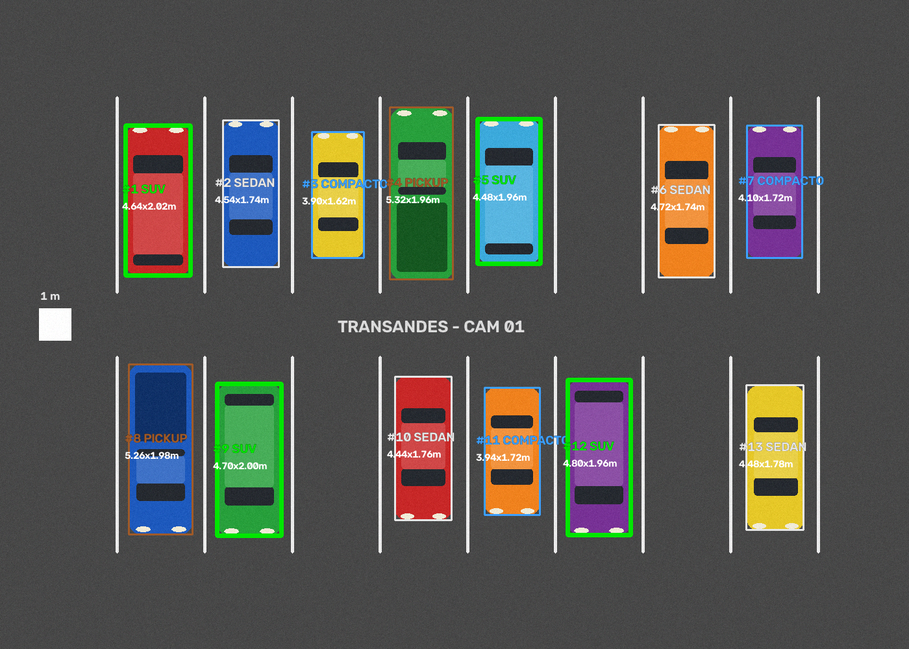
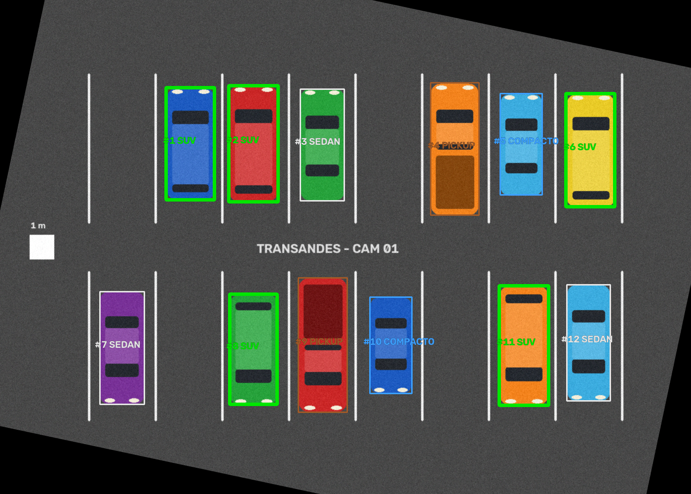

# 🚙 FlotaVisión — Detector de camionetas SUV con visión computacional

Sistema de **visión computacional y Machine Learning** que mira un patio de estacionamiento desde una **cámara cenital**, detecta cada vehículo, mide su **largo, ancho y área en metros** y lo clasifica en **COMPACTO · SEDÁN · SUV · PICKUP**.

> Proyecto del curso *Machine Learning y Deep Learning* — Ingeniería de Software con IA (SENATI, Semestre IV).

<p align="center">
  
  
</p>

## 📖 El caso

*TransAndes Logística* (empresa ficticia) alquila vehículos a mineras de Arequipa. Una minera exige **camionetas SUV**, y hoy un supervisor las cuenta a mano con una libreta y suele confundir sedanes grandes con SUV. FlotaVisión usa la cámara del patio para hacerlo de forma automática, de día y de noche.

## ⚙️ Cómo funciona

```
Adquisición → Preprocesamiento → Segmentación → Detección → Reconocimiento → Decisión
```

- **Detección con caja rotada** (`cv2.minAreaRect`): mide largo y ancho aunque el auto esté girado.
- **Calibración automática** del ángulo de la cámara con un patrón, para pasar de píxeles a **metros**.
- **Dos modelos de Machine Learning** comparados: **k-NN** y **Árbol de decisión** (que muestra las reglas que aprendió).
- **Validación** del sistema con **20 estacionamientos simulados**.
- Las imágenes y los datos se **generan dentro del notebook**, así que no necesita archivos externos.

## 🧰 Tecnologías

Python · OpenCV · NumPy · Pandas · scikit-learn · Matplotlib · Jupyter Notebook

## 📁 Estructura

```
FlotaVision_SUV.ipynb   Notebook principal con todo el pipeline
datos/                  Flota etiquetada usada para entrenar
imagenes/               Patio de día y de noche
resultados/             Imágenes inspeccionadas y reportes por turno (CSV)
```

## ▶️ Cómo ejecutarlo

```bash
pip install opencv-python numpy pandas scikit-learn matplotlib jupyter
jupyter notebook FlotaVision_SUV.ipynb
```

Ejecuta las celdas en orden (**Kernel → Restart & Run All**).

---

👤 **Angel Lecarnaque** · [GitHub](https://github.com/lecarnaquemauricioangel-cmd) · [LinkedIn](https://www.linkedin.com/in/angel-lecarnaque-53483044b)
